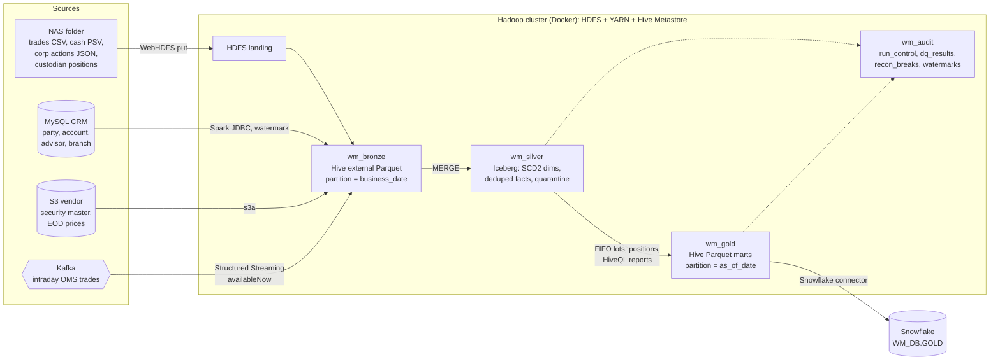

# Wealth Management EOD Batch on Hadoop

A small but complete **end-of-day books-and-records batch** for a wealth-management firm,
built on the Hadoop ecosystem: **Spark (PySpark) on YARN, Hive, Iceberg, Airflow, Kafka,
MySQL, S3 and Snowflake**. It ingests the feeds a WM firm really gets every evening,
computes positions, FIFO tax lots, realized/unrealized gains, cash and advisor AUM, runs
middle-office reconciliation, and publishes marts to Snowflake.

For the interview walkthrough (domain, design decisions, JD mapping, likely questions)
read **[docs/INTERVIEW_GUIDE.md](docs/INTERVIEW_GUIDE.md)**.

## Architecture



Airflow (`wm_eod_batch`) orchestrates; every heavy step is `spark-submit --master yarn
--deploy-mode cluster`. The DAG graph is in the docstring of
[airflow/dags/wm_eod_batch_dag.py](airflow/dags/wm_eod_batch_dag.py).

## How it fits your machine

This project **reuses the Hadoop stack in `~/aether_trade_project`** (HDFS, YARN, Hive
3.1.3, Spark 3.5.3, Airflow 2.9) and changes none of its files:

| Piece | Where it runs |
|---|---|
| HDFS, YARN, Hive Metastore, HiveServer2, Spark | aether containers |
| Airflow scheduler/webserver | aether containers, plus this project's mounts via [docker-compose.airflow-override.yml](docker-compose.airflow-override.yml) |
| MySQL 8.4 (`wm-mysql`), Kafka 3.8 KRaft (`wm-kafka`) | [docker-compose.yml](docker-compose.yml), joined to the `aether-bigdata` network |
| S3 | your AWS account (optional; `WM_MARKET_SOURCE=hdfs` works offline) |
| Snowflake | your account, `wm` connection (optional; `WM_SNOWFLAKE_ENABLED`) |

YARN has one 4 GB NodeManager, so Spark tasks share the Airflow pool `wm_yarn` (1 slot).

## Run it

```bash
make up          # data + build + start aether stack, MySQL, Kafka, pool, topic
```

Then run three business days. Each is a full batch; open Airflow at
http://localhost:8080 and YARN at http://localhost:8088 to watch.

```bash
make trigger DATE=2026-11-06      # initial history load (3+ years of trades)
```

```bash
make crm-changes                  # FA 9040 leaves, their book moves to FA 9012, new client
```

```bash
make day DATE=2026-11-09          # publishes the day's Kafka events, then runs the batch
```

```bash
make day DATE=2026-11-10          # includes a 2-for-1 stock split on SEC00001
```

Check results:

```bash
scripts/dag_status.sh             # task states of the latest run
```

```bash
make status                       # run_control + failed DQ checks from Hive
```

```bash
make beeline                      # e.g. SELECT * FROM wm_gold.advisor_book_daily WHERE as_of_date='2026-11-10' AND agg_level='REGION';
```

Optional real-cloud pieces:

```bash
make seed-s3            # needs WM_S3_BUCKET in .env; then set WM_MARKET_SOURCE=s3
```

```bash
make snowflake-setup    # creates WM_DB.GOLD tables; then set WM_SNOWFLAKE_ENABLED=true
```

After changing `.env`, run `make up` again so Airflow picks it up.

Unit tests (pytest, local SparkSession, inside the cluster image):

```bash
make test
```

## Verified results (full runs on the Docker cluster, 2026-11-10)

All three business dates ran end to end on YARN, then published to Snowflake.

| Check | 2026-11-06 | 2026-11-09 | 2026-11-10 |
|---|---|---|---|
| Positions (Hive = Snowflake) | 11,515 | 11,666 | 11,808 |
| Accounts valued | 2,300 | 2,301 | 2,301 |
| Firm AUM | $1.289B | $1.290B | |
| Recon breaks | 5 (all planted) | 5 (all planted) | 5 (all planted) |
| Quarantined rows | 6 | 9 | 9 |

- **Idempotent**: 11-06 ran twice and gave identical results (21,275 trades = 21,275 distinct IDs, bronze not doubled).
- **Silver row count reconciles**: in = merged + rejected + duplicates + superseded versions.
- **Kafka**: 306 events, 304 distinct; the end-of-day file version wins over the stream.
- **SCD2**: 2,380 account versions, 2,321 current. FA 9040's book stays with FA 9040 for 11-06 and moves to FA 9012 from 11-09.
- **2-for-1 split on SEC00001**: quantity doubled, price halved, cost basis unchanged. Recon still matches the custodian.
- **Snowflake**: all 15 table/date counts in `WM_DB.GOLD` equal Hive gold.

Bugs found by the first real run (good interview stories):
- `13/45/2026` raised `SparkUpgradeException` instead of becoming NULL. Fixed with `spark.sql.legacy.timeParserPolicy=CORRECTED`.
- `F.nullif` failed on an unresolved column in PySpark 3.5. Replaced with `when`.
- Recreating the `dist/` folder left the Airflow bind mount empty. `make build` now replaces files in place.

## Layout

```
airflow/dags/wm_eod_batch_dag.py   orchestration (sensor, WebHDFS landing, spark-submit tasks, pool)
jobs/run.py                        single spark-submit entry point: --job <name> --business-date
wm_pipeline/
  context.py                       SparkSession, config, run_control audit, insert_overwrite
  schemas.py                       explicit schemas for every feed (DECIMAL money)
  quality.py                       DQ checks -> wm_audit.dq_results, fail on CRITICAL
  transforms/                      pure, unit-tested logic: FIFO lots, SCD2 staging, trade rules
  jobs/                            one module per DAG step (bronze_*, silver_*, gold_*, recon, publish)
  resources/hive/*.hql             Hive DDL + HiveQL reporting (also runnable in beeline)
  resources/iceberg/01_silver.sql  Iceberg silver tables
conf/pipeline.json                 non-secret settings (paths, JDBC, Kafka, tax rates, thresholds)
sql/mysql/                         CRM schema, generated seed, day-2 changes
sql/snowflake/01_setup.sql         Snowflake serving tables
scripts/generate_data.py           deterministic synthetic data (stdlib only)
tests/                             pytest unit tests
```

## Data you get

| Feed | Volume | Deliberate problems to handle |
|---|---|---|
| CRM (MySQL) | 8 branches, 40 FAs, 1,500 parties, 2,320 accounts | day-2 FA departure, risk-profile changes, new client (SCD1/SCD2) |
| Trades (NAS CSV + Kafka) | ~21k history, ~300/day | malformed price, missing account, orphan account, duplicates, corrections (v2), same-day cancels, at-least-once Kafka redelivery |
| Cash (NAS PSV) | ~71k | `MM/dd/yyyy` dates, one invalid date |
| Corporate actions (JSON) | split + dividends | nested struct, one broken JSON line, 2:1 split on 2026-11-10 |
| Custodian positions | every holding | 3 quantity breaks, 1 missing, 1 extra per day |
| Market data (S3) | 120 securities, 12 days of prices | Hive-style `price_date=` partitions |
| Skew | 25 trust accounts of the Private Wealth team trade ~15x more | for AQE/broadcast/salting discussion |
